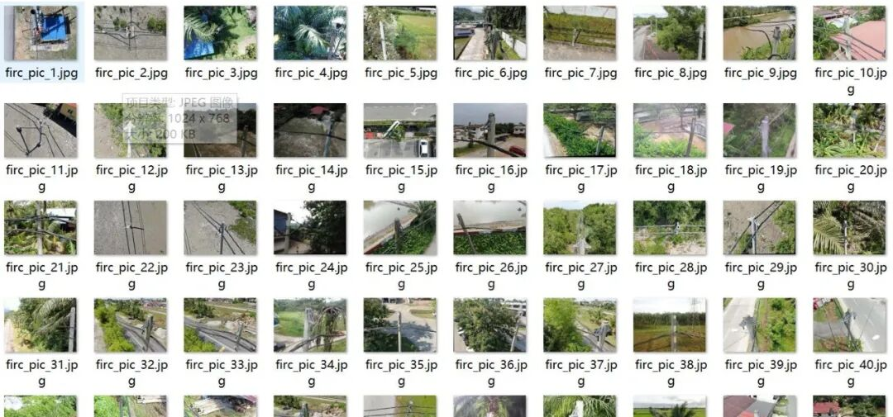
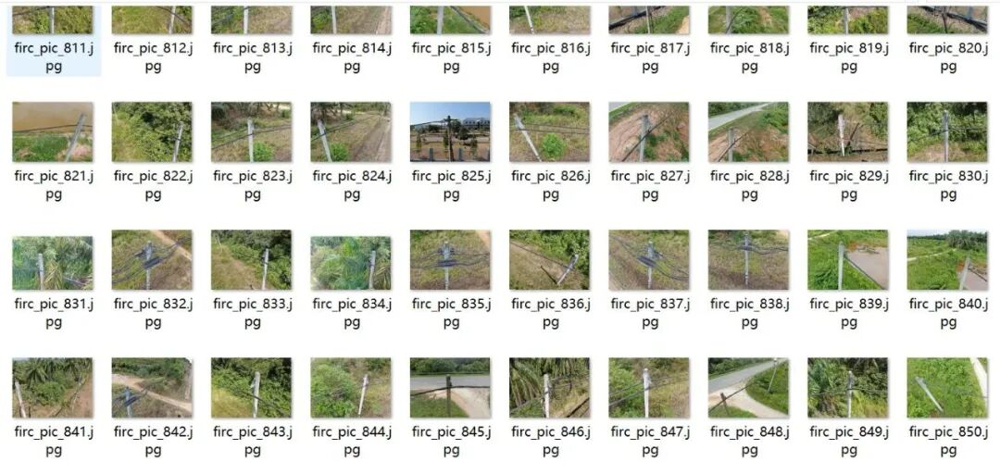
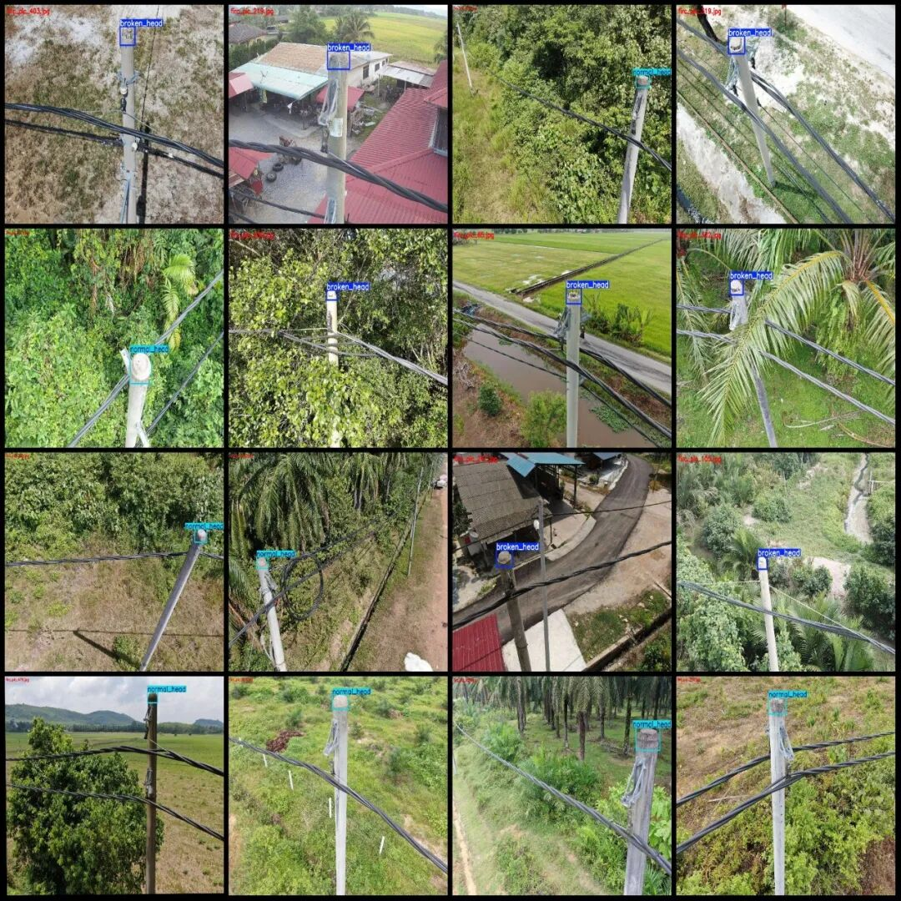
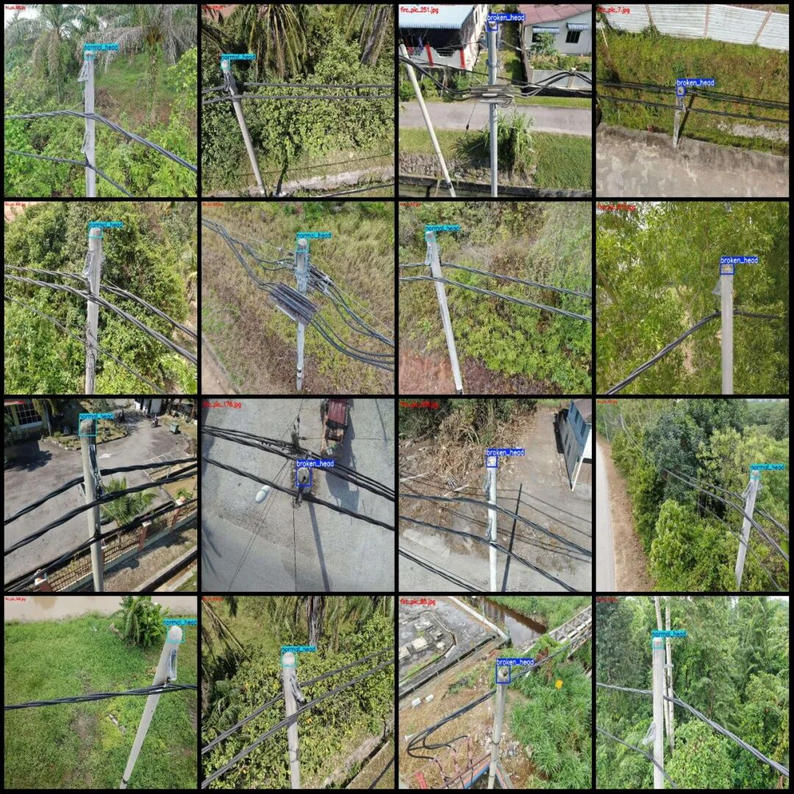
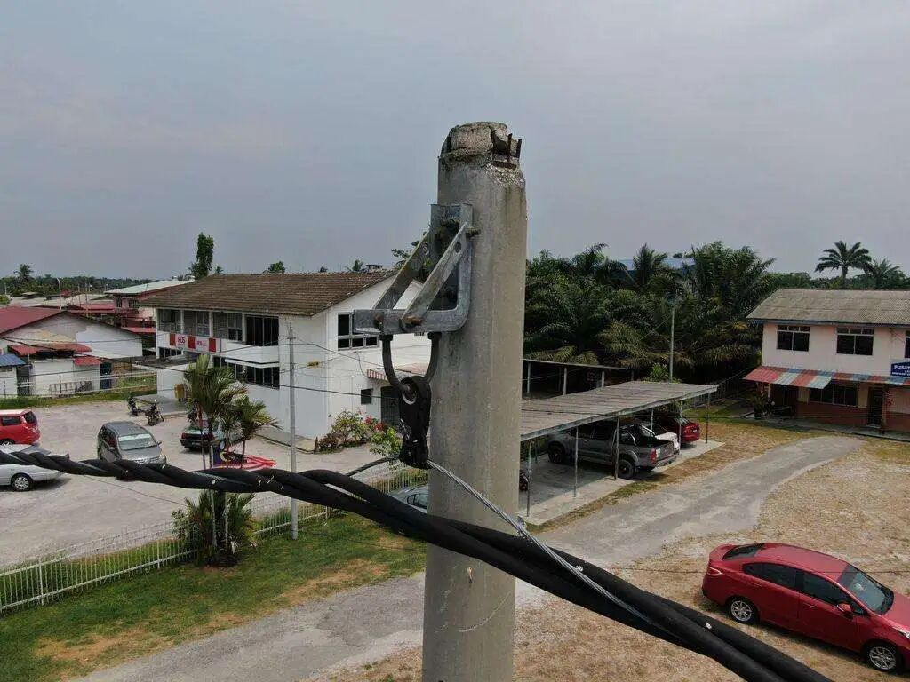
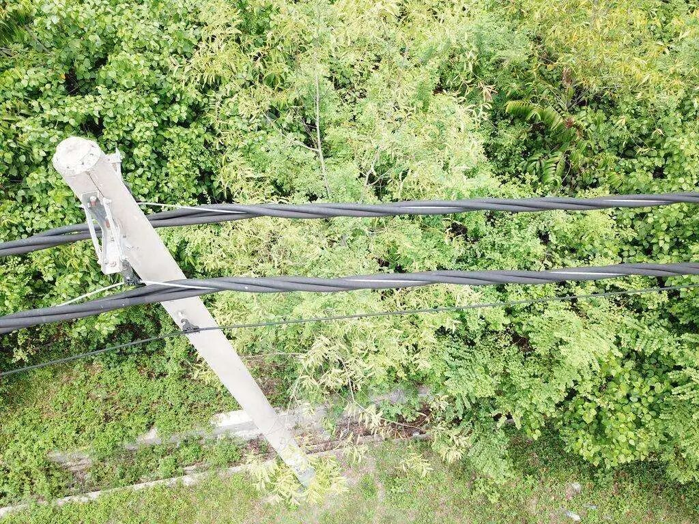
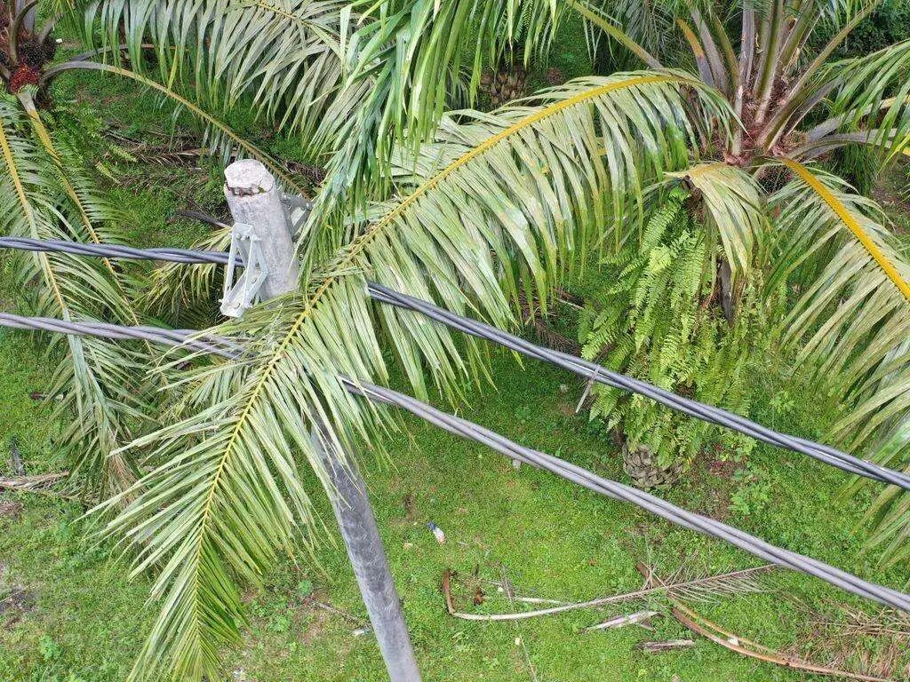

# Power Scenery Transmission Line Pole Tower Head Injury and Damage Detection Dataset VOC+YOLO format 981 categories

Dataset format: Pascal VOC format + YOLO format (txt file without split path, only containing jpg images and corresponding VOC format xml files and yolo format txt files)

Number of images (number of jpg files): 981

Number of annotations (number of xml files): 981

Number of annotations (number of txt files): 981

Labeling category count: 2

Label category names (Note that the order of yolo format categories does not correspond to this, but is based on the labels folder's classes.txt): ["broken_head", "normal_head"]

Number of boxes labeled in each category:

broken_head frame count = 525

Normal_head frame count = 458

Total frame count: 983

Number of images per category:

broken_head occupies = 523

normal_head occupies = 458

Image resolution: 1024x768

Using labelImg:

Annotation rules: Draw a rectangle around the category.

Important Notice: The dataset does not have separate training, validation, and test sets; you need to partition them yourself.

Special : This dataset does not guarantee the accuracy of the trained models or weight files.

Image Preview:

Annotation example:

Single image:

## Payment

Here is a pay link on Stripe ( https://buy.stripe.com/3cs8yP7sY87d0vu9AB ). Please contact me lonlonago@foxmail.com after funding $89, and I will send you a complete data files , thank you!

